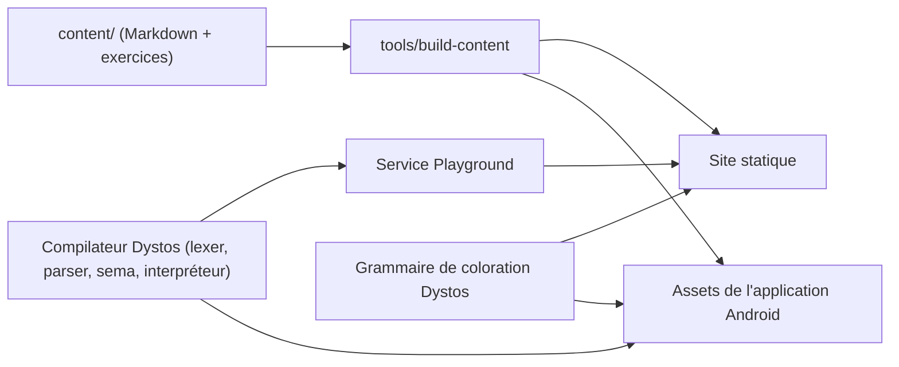

# Dystos — Plan de construction du site web et de l'application Android

*Objectif : permettre à n'importe qui d'apprendre Dystos facilement, sur le web et sur mobile, en s'inspirant de l'organisation de kotlinlang.org (page d'accueil avec code, documentation, parcours guidé, bac à sable en ligne).*

**Dépôt** : https://github.com/Lunkht/Dystos

---

## 1. Principes directeurs

| Principe | Conséquence concrète |
|---|---|
| **Souveraineté** | Aucun service Google ni tiers imposé : pas de Google Fonts, Analytics, Firebase, Play Services, CDN externes. Polices, scripts et images sont servis par nous. |
| **Hors ligne d'abord** | L'application Android contient tout le contenu et fonctionne sans réseau. Le site est statique et peut aussi être consulté hors ligne. |
| **Autohébergé** | Tout se déploie avec Docker Compose sur ton infrastructure. |
| **Une seule source de contenu** | Les leçons sont écrites une fois (Markdown + exercices) et produisent le site **et** l'application. |
| **Pédagogie progressive** | Chaque leçon = explication courte + code exécutable/analysable + exercice vérifié automatiquement. |
| **Inspiration, pas copie** | On reprend l'organisation (accueil, docs, tour, playground), pas les logos, textes, images ni la charte de Kotlin. Dystos a sa propre identité. |

---

## 2. Architecture d'ensemble



**Quatre briques partagées**
1. **`content/`** : leçons, exercices, exemples (source de vérité).
2. **Grammaire de coloration** : une définition unique des mots-clés/opérateurs de Dystos, déclinée pour le site (Prism ou Shiki/TextMate) et pour l'application (coloration par le vrai lexer).
3. **Contrat d'API du playground** (section 6) : le site et l'application s'y branchent.
4. **Compilateur** : fourni par moi, étape par étape (voir section 8).

---

## 3. Structure du dépôt (proposition)

```
Dystos/
├── compiler/            # lexer, parser, ... (déjà en place)
├── content/             # leçons et exercices (Markdown + YAML)
│   ├── fr/
│   └── en/              # plus tard
├── site/                # site web (React + TypeScript)
├── apps/android/        # application Android (Java)
├── services/playground/ # service d'exécution/analyse en ligne
├── tools/build-content/ # génère le site et les assets Android
├── deploy/              # docker-compose, reverse proxy
└── docs/                # spécification, architecture
```

---

## 4. Le site web

### 4.1 Plan du site

| Section | Contenu | Inspiration |
|---|---|---|
| **Accueil** | Slogan, exemple de code Dystos mis en avant avec coloration, boutons « Essayer en ligne » et « Commencer », 3-4 points forts (lisible comme Python, sûr comme Java, tourne sur la JVM, interop Java), extraits d'exemples | Page d'accueil avec code |
| **Démarrer** | Installation, premier programme, outils (CLI, éditeur) | « Get started » |
| **Apprendre** | Tour guidé en leçons courtes + exercices | « Kotlin Tour » / Koans |
| **Documentation** | Guide du langage, référence (grammaire, types), bibliothèque standard, interop Java, architecture du compilateur | « Docs » |
| **Playground** | Éditeur en ligne : écrire, analyser, exécuter | « Try Kotlin » |
| **Exemples** | Les 20 programmes de la Phase 0 puis une galerie | « Examples » |
| **Actualités** | Blog des versions et décisions de conception | « Blog » |
| **Communauté** | Dépôt GitHub, comment contribuer, signaler un bug | « Community » |
| **Téléchargements** | Versions du compilateur, application Android (APK) | « Install » |

### 4.2 Choix techniques

| Sujet | Recommandation | Raison |
|---|---|---|
| Générateur | **Docusaurus** (React + TypeScript) avec pages d'accueil personnalisées | Tu maîtrises React/TS ; docs, blog, versions et traduction (i18n) sont natifs |
| Alternative | Astro ou VitePress | Plus léger, mais moins de fonctions « docs » prêtes à l'emploi |
| Recherche | Plugin de recherche **locale** (index généré au build) | Pas d'Algolia ni de service tiers ; à évaluer au moment du choix |
| Coloration du code | Grammaire Dystos (TextMate/Prism) dans `docs/` | Réutilisable pour VS Code plus tard |
| Polices | Polices libres **auto-hébergées** (ex. Inter et JetBrains Mono, licence OFL) | Pas de Google Fonts |
| Thème | Clair/sombre, contraste AA, navigation clavier, responsive | Accessibilité |
| Statistiques | Aucune par défaut ; option Matomo/Plausible **autohébergé** | Respect de la vie privée |
| Hébergement | Conteneur statique derrière un reverse proxy (Caddy ou Nginx) | S'intègre à ton Docker Compose |

### 4.3 Composants à construire

1. **En-tête** avec navigation, bascule clair/sombre, sélecteur de langue.
2. **Hero** : titre, sous-titre, bloc de code avec coloration, deux boutons d'action.
3. **Bloc de code exécutable** : bouton « Exécuter » qui appelle le playground ; sortie affichée dessous.
4. **Éditeur du playground** : éditeur de code léger (CodeMirror est un bon candidat open source), diagnostics soulignés (lignes/colonnes issues des erreurs du compilateur), onglets Sortie / Jetons / AST.
5. **Lecteur de leçon** : explication à gauche, exercice à droite (comme les Koans), vérification automatique, indices.
6. **Table des matières** latérale, « Page précédente/suivante », fil d'Ariane.
7. **Pied de page** : licences, dépôt, contact.

### 4.4 Identité visuelle (à décider par toi)

Le nom **Dystos** (de « dystopiques ») invite à une ambiance sombre et technique : fond sombre par défaut, un accent de couleur vive, grande lisibilité du code. À définir : logo, palette (6 à 8 variables CSS), ton éditorial. Je peux proposer 2-3 palettes si tu veux.

---

## 5. L'application Android

### 5.1 Fonctions

| Fonction | Détail | Hors ligne |
|---|---|---|
| **Parcours d'apprentissage** | Chapitres → leçons → exercices, progression sauvegardée | ✅ |
| **Éditeur de code mobile** | Coloration syntaxique, numéros de ligne, **barre de symboles rapides** (`:` `(` `)` `[` `]` `{` `}` `->` `?.` `?:` `"` `_`) car taper ces signes sur mobile est pénible | ✅ |
| **Vérification du code** | Erreurs lexicales/syntaxiques affichées en direct (le lexer et le parser existent déjà) ; erreurs de types après la Phase 2 | ✅ |
| **Exécution locale** | Via un interpréteur embarqué (voir section 8) ; avant, mode « analyse seule » | ✅ |
| **Exercices à vérification automatique** | Comparaison de la sortie attendue, indices, solution | ✅ |
| **Référence rapide** | Mots-clés, opérateurs, bibliothèque standard, aide-mémoire | ✅ |
| **Recherche** | Recherche plein texte dans les leçons (SQLite FTS) | ✅ |
| **Quiz** | QCM de révision | ✅ |
| **Exemples** | Les 20 programmes, ouvrables dans l'éditeur | ✅ |
| **Thème** | Clair/sombre | ✅ |
| **Partage** | Partager un extrait de code (texte/fichier `.dys`) | ✅ |
| **Synchronisation (option)** | Progression vers ton serveur auto-hébergé | ❌ (optionnel, plus tard) |

### 5.2 Architecture (Clean Architecture, Java)

```
presentation/   Activity, Fragment, ViewModel, adaptateurs, vues personnalisées (éditeur)
domain/         entités (Lesson, Exercise, Progress), cas d'usage, interfaces de dépôts
data/           dépôts, Room (SQLite), chargement des assets, mappers
language/       adaptateur vers le compilateur Dystos (lexer, parser, sema, interpréteur)
core/           utilitaires, exécuteurs de threads, thèmes
```

- **Langage** : Java, vues XML + composants Material, ViewModel/LiveData (AndroidX). AndroidX est open source et sans Play Services ; on évite en revanche tout ce qui dépend des services Google.
- **Données** : Room pour la progression et l'index de recherche ; contenu embarqué dans `assets/`.
- **Éditeur** : vue personnalisée (`EditText` avec `Spannable`) colorée par le vrai lexer de Dystos ; recoloration différée (debounce) pour la fluidité.
- **Exécution du code utilisateur** : thread dédié, **délai maximal** (ex. 5 s), **taille de sortie limitée**, **aucun accès fichiers/réseau** pour le code de l'apprenant.
- **Distribution** : APK téléchargeable depuis le site et dépôt F-Droid auto-hébergé ; le Play Store reste facultatif.

### 5.3 Compatibilité du compilateur avec Android (point technique à traiter tôt)

Le lexer et le parser sont compilés en Java 21. Pour les embarquer dans Android il faudra :
- vérifier les fonctionnalités de langage utilisées (records, interfaces scellées, `switch`) et la prise en charge par la chaîne de build Android ;
- recompiler ces modules avec une cible plus basse (ex. Java 17) si nécessaire ;
- activer le *core library desugaring* pour les API Java récentes si le `minSdk` choisi l'exige.

Je prépare les modules du compilateur pour que ce soit simple : dis-moi ton **minSdk** cible et je vérifie la compatibilité de mon côté.

---

## 6. Contrats entre le compilateur, le site et l'application

### 6.1 Format d'un diagnostic (erreur ou avertissement)

```json
{
  "severity": "error",
  "code": "E0101",
  "message": "ligne 3, colonne 5 : '}' sans délimiteur ouvrant",
  "line": 3,
  "column": 5,
  "endLine": 3,
  "endColumn": 6
}
```
`endLine` et `endColumn` sont optionnels au début. Le site souligne la zone ; l'application affiche une pastille d'erreur dans la marge.

### 6.2 API du playground (v1)

**`POST /api/v1/analyze`** : analyse sans exécuter.
```json
{ "code": "def main():\n    print(1)\n", "include": ["tokens", "ast"] }
```
Réponse : `{ "diagnostics": [...], "tokens": [...], "ast": "..." }`

**`POST /api/v1/run`** : analyse puis exécute (disponible quand l'exécution existe).
```json
{ "code": "...", "stdin": "" }
```
Réponse : `{ "stdout": "...", "stderr": "...", "exitCode": 0, "durationMs": 42, "diagnostics": [...] }`

**Limites proposées** : code ≤ 20 Ko, durée ≤ 5 s, mémoire ≤ 128 Mo, sortie ≤ 64 Ko, limitation de débit par adresse IP.

### 6.3 Sécurité du playground (obligatoire)

Exécuter du code inconnu est dangereux. Règles minimales : conteneur Docker dédié **sans réseau**, système de fichiers en lecture seule, utilisateur non privilégié, limites CPU/mémoire/durée, pas de secrets dans le conteneur, journalisation, et une exécution par conteneur éphémère. Le service ne doit jamais tourner sur la même machine/réseau que des données sensibles.

### 6.4 Format du contenu (`content/`)

Une leçon = un fichier Markdown avec en-tête :
```yaml
---
id: classes-et-constructeurs
titre: Classes et constructeurs
chapitre: objets
ordre: 8
exemple: 08-classes-et-constructeurs
---
```
Un exercice (même fichier ou fichier voisin) :
```yaml
exercice:
  consigne: "Complète la méthode `deposer`."
  code_initial: |
    class Compte:
        _solde: float = 0.0
        def deposer(self, montant: float):
            # à compléter
  sortie_attendue: "Compte(Awa, 150.0)"
  indices: ["Utilise self._solde"]
  solution: |
    ...
```
`tools/build-content` valide ce schéma, puis génère les pages du site et le paquet d'assets de l'application (JSON + index de recherche).

---

## 7. Programme pédagogique (réutilise les 20 exemples de la Phase 0)

| Chapitre | Leçons | Exemples |
|---|---|---|
| 1. Premiers pas | Hello world, variables et `val`/`var`, fonctions | 01, 02, 03 |
| 2. Contrôle | Conditions, boucles | 04 |
| 3. Données | Collections, compréhensions, texte et f-strings | 05, 06, 07 |
| 4. Objets | Classes, héritage et interfaces, génériques | 08, 09, 10 |
| 5. Sûreté | `null` et `?`, exceptions | 11, 12 |
| 6. Fonctionnel | Lambdas, fonctions d'ordre supérieur | 13 |
| 7. Structurer | Enum et `match`, packages et visibilité | 14, 18 |
| 8. Monde réel | Fichiers, interop Java, concurrence | 15, 16, 17 |
| 9. Qualité | Tests intégrés | 19 |
| 10. Projet | Gestion de stock complète | 20 |

Chaque leçon : 5 minutes de lecture, 1 exemple, 1 à 3 exercices.

---

## 8. Planification en parallèle

Hypothèse : tu construis le site et l'application ; je continue le compilateur. Les durées sont indicatives (travail à temps partiel).

| Jalon | Semaines | Compilateur (moi) | Site (toi) | Application (toi) |
|---|---|---|---|---|
| **J0 Cadrage** | 1-2 | Phase 2 : table des symboles et résolution des noms | Identité, nom de domaine, choix Docusaurus, schéma `content/`, grammaire de coloration | Choix du minSdk, squelette Clean Architecture, schéma `content/` |
| **J1 Squelettes** | 3-5 | Phase 2 : système de types, null-safety, diagnostics au format JSON | Landing, thème clair/sombre, pages de doc (spec Phase 0), coloration | Écrans : liste de chapitres, lecteur de leçon, thème |
| **J2 Parcours** | 6-9 | Service playground v0 : `analyze` (jetons, AST, erreurs) | Tour (chapitres 1-4), lecteur de leçon, éditeur du playground | Éditeur avec coloration et barre de symboles, diagnostics lexicaux/syntaxiques |
| **J3 Erreurs de types** | 10-13 | Diagnostics de types dans `analyze` ; **mini-interpréteur d'AST** | Tour (chapitres 5-8), exercices, recherche locale | Exercices, progression (Room), recherche, quiz |
| **J4 Exécution** | 14-19 | `run` (interpréteur, puis backend JVM de la Phase 3) | Exécution dans le playground et dans les leçons | Exécution locale avec l'interpréteur embarqué |
| **J5 Finitions** | 20-23 | Bibliothèque standard, messages d'erreur soignés | Blog, anglais (i18n), téléchargements, audit d'accessibilité | Aide-mémoire, partage, APK signé, F-Droid |
| **J6 Bêta publique** | 24 | Version 1.0-bêta du compilateur | Mise en ligne | Publication |

**Recommandation de séquencement** : insérer un **interpréteur d'AST minimal** juste après la Phase 2 (avant le backend JVM). Il débloque l'exécution dans le playground et dans l'application bien plus tôt, sans attendre la génération de bytecode. Le backend JVM de la Phase 3 reste nécessaire pour la performance et les `.jar`.

### Ce que tu peux commencer dès maintenant (sans attendre le compilateur)
1. Squelette du site et page d'accueil avec un bloc de code **statique** coloré.
2. Schéma `content/` et les 3 à 5 premières leçons (chapitre 1).
3. Squelette de l'application et lecteur de leçons hors ligne.
4. Maquettes (accueil, leçon, éditeur mobile).

### Ce que je te fournis, dans l'ordre
1. **Grammaire de coloration** de Dystos (TextMate/Prism) générée à partir des jetons du lexer.
2. **Format JSON des diagnostics** (section 6.1) branché sur le compilateur.
3. **Commande `dystos check --json`** et **service playground v0** (`analyze`).
4. **Vérification de compatibilité Android** des modules du compilateur.
5. **Interpréteur d'AST** pour l'exécution.

---

## 9. Risques et mitigations

| Risque | Impact | Mitigation |
|---|---|---|
| Exécution de code malveillant (playground) | Élevé | Conteneurs éphémères sans réseau, limites strictes (6.3) |
| Compilateur Java 21 non embarquable tel quel sur Android | Moyen | Test de compatibilité tôt (5.3), cible Java plus basse si besoin |
| Dérive du périmètre (trop de fonctions d'un coup) | Élevé | Lancer avec parcours + éditeur + vérification ; exécution en J4 |
| Saisie difficile sur mobile | Moyen | Barre de symboles, indentation automatique, auto-fermeture des brackets |
| Contenu dupliqué entre site et application | Moyen | Source unique `content/` + `build-content` |
| Pédagogie trop dense | Moyen | Leçons de 5 minutes, exercices progressifs, tests avec de vrais débutants |
| Dépendance à des services tiers qui s'infiltre | Moyen | Revue des dépendances à chaque jalon (aucun CDN, aucune police externe) |

---

## 10. Critères d'acceptation

**Site** : toutes les pages fonctionnent sans requête vers un domaine externe ; accessibilité AA ; Lighthouse ≥ 90 en performance et accessibilité ; le playground renvoie des diagnostics corrects sur les 20 exemples.
**Application** : tout le parcours utilisable en mode avion ; coloration fluide sur un appareil d'entrée de gamme ; aucune permission réseau obligatoire ; exécution interrompue proprement au-delà du délai.
**Contenu** : chaque exercice a une solution validée automatiquement par le compilateur ; le build échoue si un exemple ne passe plus après un changement du langage.

---

## 11. Décisions à prendre (de ton côté)

1. **Nom de domaine** et hébergement du site.
2. **Identité visuelle** : logo, palette, ton.
3. **Langues** : français seul au départ, anglais à partir de J5 ?
4. **minSdk** de l'application.
5. **Générateur du site** : Docusaurus (recommandé) ou une autre option.
6. **Distribution** de l'application : APK direct + F-Droid, Play Store en plus ou non.
7. **Statistiques** : aucune, ou outil autohébergé.
